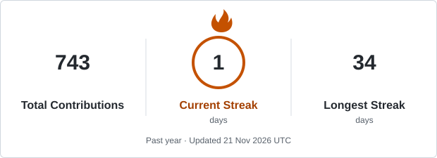
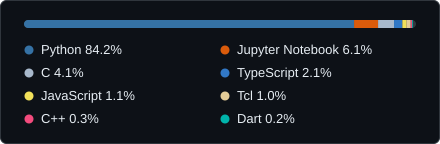

<h1 align="center">Hi, I’m Jerrin Anto 👋</h1>

<h3 align="center">I’m a passionate developer from India 🇮🇳</h3>

- 🌱 **Currently learning · Forward-deployed engineering**\
  I’m studying how cloud services scale when AI workloads spike and how that affects REST API performance.

- 🎥 **Tech Content Creation · CodeWithJeru**\
  I share tutorials and project walkthroughs on AI, software engineering, cloud, Linux, automation, and developer workflows. [Instagram](https://www.instagram.com/codewithjeru/) · [YouTube](https://www.youtube.com/@Tech2007-g5m)

- 🛠️ **Chairperson · ForMae**\
  I serve as Chairperson of [ForMae](https://forma-9c8t.onrender.com/) (November 2026–present), a technology community focused on collaboration, practical learning, and real-world projects. I previously served as Founder from October 2025 to November 2026.

- 🚀 **Founder’s Office · Nexstep Network**\
  I’m part of the Founder’s Office at Nexstep Network (November 2026–present), following my roles as Startup Builder (August–November 2026) and Core Developer (July–November 2026).

- 💼 **Internships**\
  I worked on AI and Python development at GIGNI, generative AI workflows and API integration at HiDevs, and AI-assisted web and mobile prototypes at Scaler School of Technology.

- 🔗 **Find me**\
  [Résumé (PDF)](https://drive.google.com/file/d/1p2h3YbaqEVjeBf-1VQ3y7pBRkurKsJ3d/view?usp=sharing) · [Portfolio](https://jerrin-ai.vercel.app/) · [LinkedIn](https://www.linkedin.com/in/jerrin-anto-74a836392/) · [LeetCode](https://leetcode.com/u/antojerrin/) · [Email](mailto:ajant2007@gmail.com)

- 🎓 **Education**\
  I study Computer Science (AI & ML) at REVA University in Bengaluru and expect to graduate in August 2029.

 

**Project spotlight · [AQUA-ETHIC](https://github.com/ANTOJERRIN/AQUA-ETHIC)**\
I helped build the data verification workflow for an ESP32 water-quality monitoring prototype. Our four-person team reached the DECODE SIH National Grand Finale as a top-50 finalist.

 

\
[See my achievements, open-source work, and internship experience](./ABOUT.md).

## GitHub Stats

<!-- contribution-stats:start -->

<!-- contribution-stats:end -->

## Languages and Tools

My project work centers on **Python, FastAPI, React, TypeScript, and Supabase**.

  
  
  
  
  
  
  
  
  
  
  
  
  
  
  
  
  
  
  
  
  
  
  
  
  
  
  
  
  
  
  
  
  
  
  
  
  
  
  
  
  
  
  
  
  
  
  
  
  
  
  
  
  
  
  
  
  
  
  
  
  
  

 

<!-- language-stats:start -->

<!-- language-stats:end -->

## Featured Projects

  

[Browse all six projects, with implementation details and source code](./PROJECTS.md).

## Support Me

### Follow CodeWithJeru for tutorials and project walkthroughs

  
  
  

