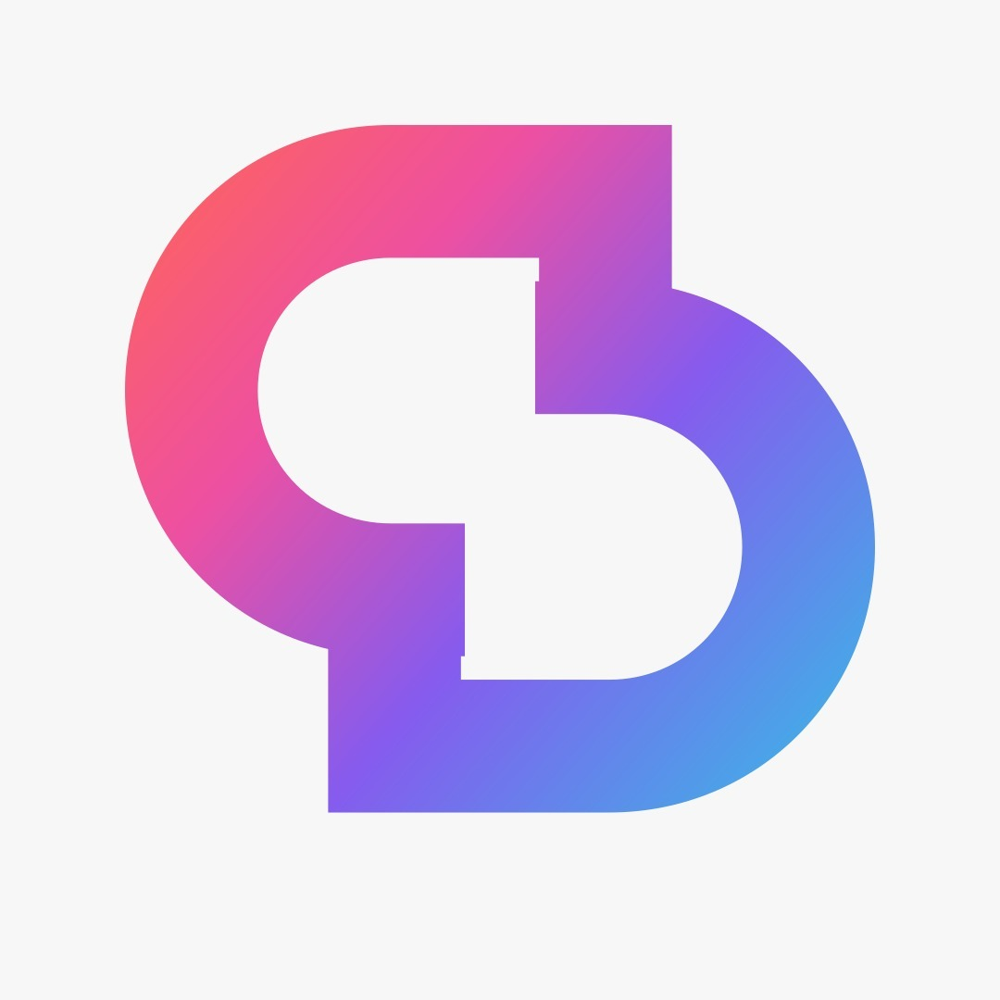
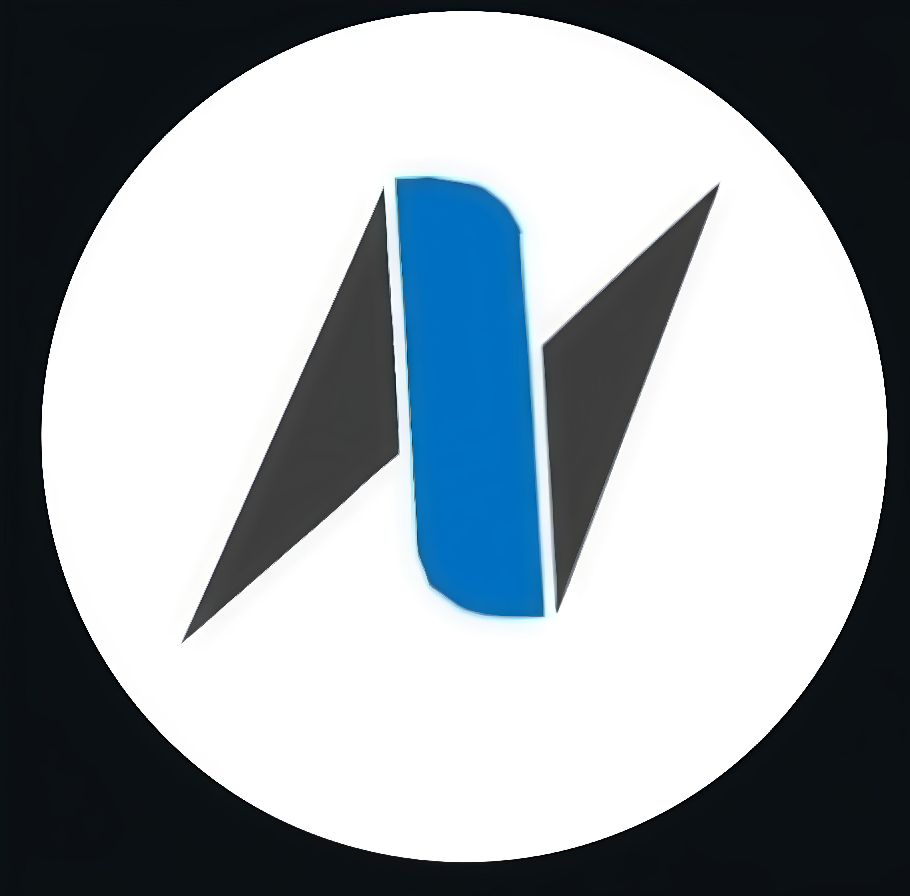

<div align="center">

<!-- Header Banner -->


<!-- Dynamic Typing Introduction -->


<br/>

<!-- ================= SOCIAL / CONNECT BADGES ================= -->
<p>
  <a href="https://linkedin.com/in/jerrin-anto-74a836392"></a>
  <a href="https://jerrin-ai.onrender.com/"></a>
  <a href="mailto:ajant2007@gmail.com"></a>
  <a href="https://www.youtube.com/@Tech2007-g5m"></a>
 <a href="https://instagram.com/jerrinanto2007"></a>
  <a href="https://leetcode.com/u/antojerrin/"></a>
</p>

<br/><br/>

<!-- Profile Views Counter -->


</div>

---

<div align="center">

### ⚡ 𝓐𝓡𝓒𝓗𝓘𝓣𝓔𝓒𝓣𝓤𝓡𝓔 • 𝓘𝓝𝓣𝓔𝓛𝓛𝓘𝓖𝓔𝓝𝓒𝓔 • 𝓢𝓒𝓐𝓛𝓔

<table>
<tr>
<td align="center" width="20%"><br/>🤖<br/><strong>𝓐𝓘 & 𝓜𝓛</strong><br/><sub>𝓟𝔂𝓣𝓸𝓻𝓬𝓱 • 𝓐𝓰𝓮𝓷𝓽𝓲𝓬 𝓐𝓘 • 𝓥𝓲𝓼𝓲𝓸𝓷</sub><br/><br/></td>
<td align="center" width="20%"><br/>⚡<br/><strong>𝓕𝓤𝓛𝓛 𝓢𝓣𝓐𝓒𝓚</strong><br/><sub>𝓕𝓪𝓼𝓽𝓐𝓟𝓘 • 𝓝𝓮𝔁𝓽.𝓳𝓼 • 𝓡𝓮𝓪𝓬𝓽</sub><br/><br/></td>
<td align="center" width="20%"><br/>☁️<br/><strong>𝓒𝓛𝓞𝓤𝓓</strong><br/><sub>𝓖𝓸𝓸𝓰𝓵𝓮 𝓒𝓵𝓸𝓾𝓭 • 𝓐𝓦𝓢 • 𝓓𝓮𝓹𝓵𝓸𝔂𝓶𝓮𝓷𝓽𝓼</sub><br/><br/></td>
<td align="center" width="20%"><br/>📱<br/><strong>𝓜𝓞𝓑𝓘𝓛𝓔 & 𝓘𝓸𝓣</strong><br/><sub>𝓕𝓵𝓾𝓽𝓽𝓮𝓻 • 𝓐𝓷𝓭𝓻𝓸𝓲𝓭 • 𝓔𝓢𝓟32 • 𝓐𝓻𝓭𝓾𝓲𝓷𝓸</sub><br/><br/></td>
<td align="center" width="20%"><br/>🚀<br/><strong>𝓢𝓣𝓐𝓡𝓣𝓤𝓟𝓢</strong><br/><sub>𝓕𝓸𝓻𝓜𝓪 • 𝓝𝓮𝔁𝓽𝓢𝓽𝓮𝓹 • 𝓟𝓻𝓸𝓭𝓾𝓬𝓽𝓲𝓸𝓷</sub><br/><br/></td>
</tr>
</table>

</div>

> *"𝓒𝓸𝓭𝓮 𝓽𝓱𝓪𝓽 𝓲𝓼𝓷'𝓽 𝓾𝓷𝓭𝓮𝓻𝓼𝓽𝓸𝓸𝓭 𝓲𝓼 𝓳𝓾𝓼𝓽 𝓫𝓸𝓻𝓻𝓸𝔀𝓮𝓭 — 𝓘 𝓫𝓾𝓲𝓵𝓭 𝓽𝓸 𝓸𝔀𝓷 𝔀𝓱𝓪𝓽 𝓘 𝓼𝓱𝓲𝓹."*

---

## 👋 𝓐𝓫𝓸𝓾𝓽 𝓜𝓮

𝓘'𝓶 **𝓐 𝓙𝓮𝓻𝓻𝓲𝓷 𝓐𝓷𝓽𝓸 (𝓐𝓷𝓽𝓸)** — 𝓪 **𝓼𝓮𝓬𝓸𝓷𝓭-𝔂𝓮𝓪𝓻 𝓑.𝓣𝓮𝓬𝓱 𝓒𝓢𝓔 (𝓐𝓘 & 𝓜𝓪𝓬𝓱𝓲𝓷𝓮 𝓛𝓮𝓪𝓻𝓷𝓲𝓷𝓰)** 𝓼𝓽𝓾𝓭𝓮𝓷𝓽, 𝓯𝓾𝓵𝓵-𝓼𝓽𝓪𝓬𝓴 𝓼𝓸𝓯𝓽𝔀𝓪𝓻𝓮 𝓮𝓷𝓰𝓲𝓷𝓮𝓮𝓻, 𝓪𝓷𝓭 𝓮𝓷𝓽𝓻𝓮𝓹𝓻𝓮𝓷𝓮𝓾𝓻𝓲𝓪𝓵 𝓼𝓽𝓪𝓻𝓽𝓾𝓹 𝓫𝓾𝓲𝓵𝓭𝓮𝓻. 𝓘 𝓼𝓹𝓮𝓬𝓲𝓪𝓵𝓲𝔃𝓮 𝓲𝓷 𝓭𝓮𝓼𝓲𝓰𝓷𝓲𝓷𝓰 𝓪𝓷𝓭 𝓭𝓮𝓹𝓵𝓸𝔂𝓲𝓷𝓰 𝓮𝓷𝓭-𝓽𝓸-𝓮𝓷𝓭 𝓲𝓷𝓽𝓮𝓵𝓵𝓲𝓰𝓮𝓷𝓽 𝓼𝔂𝓼𝓽𝓮𝓶𝓼 𝓽𝓱𝓪𝓽 𝓬𝓸𝓷𝓷𝓮𝓬𝓽 𝓻𝓸𝓫𝓾𝓼𝓽 𝓶𝓪𝓬𝓱𝓲𝓷𝓮 𝓵𝓮𝓪𝓻𝓷𝓲𝓷𝓰 𝓹𝓲𝓹𝓮𝓵𝓲𝓷𝓮𝓼 𝔀𝓲𝓽𝓱 𝓱𝓲𝓰𝓱-𝓽𝓱𝓻𝓸𝓾𝓰𝓱𝓹𝓾𝓽 𝓫𝓪𝓬𝓴𝓮𝓷𝓭𝓼, 𝓻𝓮𝓼𝓲𝓵𝓲𝓮𝓷𝓽 𝓬𝓵𝓸𝓾𝓭 𝓪𝓻𝓬𝓱𝓲𝓽𝓮𝓬𝓽𝓾𝓻𝓮, 𝓪𝓷𝓭 𝓲𝓷𝓽𝓾𝓲𝓽𝓲𝓿𝓮 𝓬𝓻𝓸𝓼𝓼-𝓹𝓵𝓪𝓽𝓯𝓸𝓻𝓶 𝓲𝓷𝓽𝓮𝓻𝓯𝓪𝓬𝓮𝓼.

𝓡𝓪𝓽𝓱𝓮𝓻 𝓽𝓱𝓪𝓷 𝓼𝓽𝓸𝓹𝓹𝓲𝓷𝓰 𝓪𝓽 𝓹𝓻𝓸𝓽𝓸𝓽𝔂𝓹𝓮𝓼, 𝓘 𝓮𝔁𝓮𝓬𝓾𝓽𝓮 𝓽𝓱𝓮 𝓯𝓾𝓵𝓵 𝓵𝓲𝓯𝓮𝓬𝔂𝓬𝓵𝓮: **𝓟𝓻𝓸𝓫𝓵𝓮𝓶 𝓓𝓮𝓯𝓲𝓷𝓲𝓽𝓲𝓸𝓷 → 𝓢𝔂𝓼𝓽𝓮𝓶 𝓐𝓻𝓬𝓱𝓲𝓽𝓮𝓬𝓽𝓾𝓻𝓮 → 𝓟𝓻𝓸𝓭𝓾𝓬𝓽𝓲𝓸𝓷 𝓒𝓸𝓭𝓮 → 𝓓𝓮𝓹𝓵𝓸𝔂𝓮𝓭 𝓟𝓻𝓸𝓭𝓾𝓬𝓽**. 𝓡𝓮𝓬𝓮𝓷𝓽𝓵𝔂, 𝓘 𝓱𝓪𝓿𝓮 𝓫𝓮𝓮𝓷 𝓭𝓸𝓾𝓫𝓵𝓲𝓷𝓰 𝓭𝓸𝔀𝓷 𝓸𝓷 𝓬𝓵𝓸𝓾𝓭 𝓬𝓸𝓶𝓹𝓾𝓽𝓲𝓷𝓰 𝓲𝓷𝓯𝓻𝓪𝓼𝓽𝓻𝓾𝓬𝓽𝓾𝓻𝓮, 𝓼𝓬𝓪𝓵𝓪𝓫𝓵𝓮 𝓫𝓪𝓬𝓴𝓮𝓷𝓭 𝓶𝓲𝓬𝓻𝓸𝓼𝓮𝓻𝓿𝓲𝓬𝓮𝓼, 𝓪𝓷𝓭 𝓪𝓾𝓽𝓸𝓷𝓸𝓶𝓸𝓾𝓼 𝓪𝓰𝓮𝓷𝓽𝓲𝓬 𝓐𝓘 𝔀𝓸𝓻𝓴𝓯𝓵𝓸𝔀𝓼.

𝓑𝓮𝔂𝓸𝓷𝓭 𝓹𝓾𝓻𝓮 𝓼𝓸𝓯𝓽𝔀𝓪𝓻𝓮, 𝓘 𝓫𝓻𝓲𝓷𝓰 𝓽𝓪𝓷𝓰𝓲𝓫𝓵𝓮 𝓫𝓾𝓼𝓲𝓷𝓮𝓼𝓼 𝓪𝓬𝓾𝓶𝓮𝓷 𝓽𝓸 𝓽𝓱𝓮 𝓽𝓪𝓫𝓵𝓮:
- 🏛️ **𝓕𝓸𝓾𝓷𝓭𝓮𝓻 𝓪𝓽 𝓕𝓸𝓻𝓜𝓪**: 𝓐 𝓭𝓾𝓪𝓵 𝓼𝓽𝓪𝓻𝓽𝓾𝓹 𝓲𝓷𝓲𝓽𝓲𝓪𝓽𝓲𝓿𝓮 𝓪𝓷𝓭 𝓬𝓸𝓵𝓵𝓪𝓫𝓸𝓻𝓪𝓽𝓲𝓿𝓮 𝓭𝓮𝓿𝓮𝓵𝓸𝓹𝓮𝓻 𝓬𝓸𝓶𝓶𝓾𝓷𝓲𝓽𝔂 𝓭𝓮𝓭𝓲𝓬𝓪𝓽𝓮𝓭 𝓽𝓸 𝓫𝓾𝓲𝓵𝓭𝓲𝓷𝓰 𝓹𝓻𝓸𝓭𝓾𝓬𝓽𝓲𝓸𝓷 𝓹𝓻𝓸𝓭𝓾𝓬𝓽𝓼 𝓪𝓷𝓭 𝓶𝓪𝓼𝓽𝓮𝓻𝓲𝓷𝓰 𝓶𝓸𝓭𝓮𝓻𝓷 𝓮𝓷𝓰𝓲𝓷𝓮𝓮𝓻𝓲𝓷𝓰 𝓼𝓽𝓪𝓬𝓴𝓼 𝓽𝓸𝓰𝓮𝓽𝓱𝓮𝓻.
- 🚀 **𝓢𝓽𝓪𝓻𝓽𝓾𝓹 𝓑𝓾𝓲𝓵𝓭𝓮𝓻 𝓪𝓽 𝓝𝓮𝔁𝓽𝓢𝓽𝓮𝓹 𝓝𝓮𝓽𝔀𝓸𝓻𝓴**: 𝓒𝓸-𝓭𝓮𝓿𝓮𝓵𝓸𝓹𝓮𝓻 𝓪𝓻𝓬𝓱𝓲𝓽𝓮𝓬𝓽𝓲𝓷𝓰 𝓪𝓷𝓭 𝓿𝓪𝓵𝓲𝓭𝓪𝓽𝓲𝓷𝓰 𝓹𝓻𝓸𝓭𝓾𝓬𝓽 𝓜𝓥𝓟𝓼.
- 🎥 **𝓣𝓮𝓬𝓱𝓷𝓸𝓵𝓸𝓰𝔂 𝓒𝓸𝓷𝓽𝓮𝓷𝓽 𝓒𝓻𝓮𝓪𝓽𝓸𝓻**: 𝓘 𝓬𝓻𝓮𝓪𝓽𝓮 𝓪𝓷𝓭 𝓼𝓱𝓪𝓻𝓮 𝓽𝓮𝓬𝓱𝓷𝓸𝓵𝓸𝓰𝔂-𝓯𝓸𝓬𝓾𝓼𝓮𝓭 𝓬𝓸𝓷𝓽𝓮𝓷𝓽 𝓸𝓷 𝓘𝓷𝓼𝓽𝓪𝓰𝓻𝓪𝓶 𝓪𝓷𝓭 𝓨𝓸𝓾𝓣𝓾𝓫𝓮, 𝓭𝓸𝓬𝓾𝓶𝓮𝓷𝓽𝓲𝓷𝓰 𝔀𝓱𝓪𝓽 𝓘 𝓵𝓮𝓪𝓻𝓷, 𝓮𝔁𝓹𝓵𝓸𝓻𝓮, 𝓪𝓷𝓭 𝓫𝓾𝓲𝓵𝓭. 𝓒𝓱𝓮𝓬𝓴 𝓸𝓾𝓽 𝓽𝓱𝓮 [𝓒𝓸𝓷𝓽𝓮𝓷𝓽 𝓒𝓻𝓮𝓪𝓽𝓲𝓸𝓷 𝓑𝓪𝓼𝓮𝓭 𝓸𝓷 𝓣𝓮𝓬𝓱𝓷𝓸𝓵𝓸𝓰𝔂](#content-creation) 𝓼𝓮𝓬𝓽𝓲𝓸𝓷 𝓫𝓮𝓵𝓸𝔀 𝓯𝓸𝓻 𝓶𝔂 𝓬𝓱𝓪𝓷𝓷𝓮𝓵𝓼.

<div align="center">

| 🎓 𝓔𝓭𝓾𝓬𝓪𝓽𝓲𝓸𝓷 | 📍 𝓡𝓸𝓵𝓮𝓼 & 𝓢𝓽𝓪𝓽𝓾𝓼 | 🛠️ 𝓟𝓻𝓲𝓶𝓪𝓻𝔂 𝓢𝓽𝓪𝓬𝓴 | 💼 𝓔𝔁𝓹𝓮𝓻𝓲𝓮𝓷𝓬𝓮 |
|---|---|---|---|
| **𝓑.𝓣𝓮𝓬𝓱 𝓒𝓢𝓔 (𝓐𝓘 & 𝓜𝓛)**<br/>𝓢𝓮𝓬𝓸𝓷𝓭-𝓨𝓮𝓪𝓻 𝓤𝓷𝓭𝓮𝓻𝓰𝓻𝓪𝓭𝓾𝓪𝓽𝓮 | **𝓕𝓸𝓾𝓷𝓭𝓮𝓻 @ 𝓕𝓸𝓻𝓜𝓪**<br/>𝓢𝓽𝓪𝓻𝓽𝓾𝓹 𝓑𝓾𝓲𝓵𝓭𝓮𝓻 @ 𝓝𝓮𝔁𝓽𝓢𝓽𝓮𝓹 𝓝𝓮𝓽𝔀𝓸𝓻𝓴 | **𝓟𝔂𝓽𝓱𝓸𝓷 • 𝓕𝓪𝓼𝓽𝓐𝓟𝓘 • 𝓝𝓮𝔁𝓽.𝓳𝓼**<br/>𝓡𝓮𝓪𝓬𝓽 • 𝓕𝓵𝓾𝓽𝓽𝓮𝓻 • 𝓖𝓸𝓸𝓰𝓵𝓮 𝓒𝓵𝓸𝓾𝓭 | **𝓘𝓷𝓽𝓮𝓻𝓷𝓼𝓱𝓲𝓹𝓼 @ 𝓢𝓬𝓪𝓵𝓮𝓻 𝓢𝓬𝓱𝓸𝓸𝓵 𝓞𝓯 𝓣𝓮𝓬𝓱𝓷𝓸𝓵𝓸𝓰𝔂, 𝓗𝓲 𝓓𝓮𝓿𝓼 & 𝓖𝓲𝓰𝓷𝓲**<br/>𝓖𝓢𝓢𝓸𝓒 𝓒𝓸𝓷𝓽𝓻𝓲𝓫𝓾𝓽𝓸𝓻 |

</div>

---

## 🛠️ 𝓣𝓮𝓬𝓱 𝓢𝓽𝓪𝓬𝓴

<div align="center">

<p>


</p>

</div>

---

<!-- ================= TECHNOLOGY CONTENT CREATION ================= -->
<a id="content-creation"></a>
## 🎥 𝓒𝓸𝓷𝓽𝓮𝓷𝓽 𝓒𝓻𝓮𝓪𝓽𝓲𝓸𝓷 𝓑𝓪𝓼𝓮𝓭 𝓸𝓷 𝓣𝓮𝓬𝓱𝓷𝓸𝓵𝓸𝓰𝔂

<div align="center">

<a href="https://www.instagram.com/jerrinanto2007">
  
</a>
&nbsp;
<a href="https://www.youtube.com/@Tech2007-g5m">
  
</a>

<br/><br/>

<table>
<tr>
<td align="center">

𝓘 𝓬𝓻𝓮𝓪𝓽𝓮 𝓽𝓮𝓬𝓱𝓷𝓸𝓵𝓸𝓰𝔂-𝓯𝓸𝓬𝓾𝓼𝓮𝓭 𝓬𝓸𝓷𝓽𝓮𝓷𝓽 𝓸𝓷 **𝓘𝓷𝓼𝓽𝓪𝓰𝓻𝓪𝓶 (@𝓳𝓮𝓻𝓻𝓲𝓷𝓪𝓷𝓽𝓸2007)** 𝓪𝓷𝓭 **𝓨𝓸𝓾𝓣𝓾𝓫𝓮 (𝓣𝓮𝓬𝓱2007)**, 𝓼𝓱𝓪𝓻𝓲𝓷𝓰 𝓶𝔂 𝓵𝓮𝓪𝓻𝓷𝓲𝓷𝓰 𝓳𝓸𝓾𝓻𝓷𝓮𝔂, 𝓼𝓸𝓯𝓽𝔀𝓪𝓻𝓮 𝓫𝓾𝓲𝓵𝓭𝓼, 𝓪𝓷𝓭 𝓮𝔁𝓹𝓮𝓻𝓲𝓶𝓮𝓷𝓽𝓼. 𝓓𝓻𝓪𝔀𝓲𝓷𝓰 𝓸𝓷 𝓶𝔂 𝔀𝓸𝓻𝓴 𝓲𝓷 𝓐𝓘 𝓪𝓷𝓭 𝓼𝓸𝓯𝓽𝔀𝓪𝓻𝓮 𝓭𝓮𝓿𝓮𝓵𝓸𝓹𝓶𝓮𝓷𝓽, 𝓘 𝓪𝓲𝓶 𝓽𝓸 𝓶𝓪𝓴𝓮 𝓽𝓮𝓬𝓱𝓷𝓲𝓬𝓪𝓵 𝓲𝓭𝓮𝓪𝓼 𝓮𝓪𝓼𝓲𝓮𝓻 𝓽𝓸 𝓾𝓷𝓭𝓮𝓻𝓼𝓽𝓪𝓷𝓭 𝓪𝓷𝓭 𝓮𝓷𝓬𝓸𝓾𝓻𝓪𝓰𝓮 𝓸𝓽𝓱𝓮𝓻𝓼 𝓽𝓸 𝓮𝔁𝓹𝓵𝓸𝓻𝓮, 𝓵𝓮𝓪𝓻𝓷, 𝓪𝓷𝓭 𝓫𝓾𝓲𝓵𝓭 𝓪𝓵𝓸𝓷𝓰𝓼𝓲𝓭𝓮 𝓶𝓮.

**𝓓𝓸 𝓵𝓲𝓴𝓮, 𝓼𝓾𝓹𝓹𝓸𝓻𝓽, 𝓪𝓷𝓭 𝓯𝓸𝓵𝓵𝓸𝔀 𝓸𝓾𝓻 𝓬𝓱𝓪𝓷𝓷𝓮𝓵𝓼!** 𝓕𝓸𝓵𝓵𝓸𝔀 𝓸𝓷 𝓘𝓷𝓼𝓽𝓪𝓰𝓻𝓪𝓶 𝓪𝓷𝓭 𝓼𝓾𝓫𝓼𝓬𝓻𝓲𝓫𝓮 𝓸𝓷 𝓨𝓸𝓾𝓣𝓾𝓫𝓮 𝓽𝓸 𝓳𝓸𝓲𝓷 𝓽𝓱𝓮 𝓳𝓸𝓾𝓻𝓷𝓮𝔂.

</td>
</tr>
</table>

</div>

---

<!-- ================= GITHUB ANALYTICS ================= -->
## 📊 𝓖𝓲𝓽𝓗𝓾𝓫 𝓐𝓷𝓪𝓵𝔂𝓽𝓲𝓬𝓼

### 🐙 𝓜𝓸𝓼𝓽 𝓤𝓼𝓮𝓭 𝓛𝓪𝓷𝓰𝓾𝓪𝓰𝓮𝓼

<div align="center">

<a href="https://github.com/ANTOJERRIN">
  
</a>

</div>

---

## 🚀 𝓢𝓱𝓲𝓹𝓹𝓮𝓭 & 𝓕𝓮𝓪𝓽𝓾𝓻𝓮𝓭 𝓟𝓻𝓸𝓳𝓮𝓬𝓽𝓼

<div align="center">
<table>
<tr>
<td width="50%" valign="top">

### 🌊 𝓐𝓠𝓤𝓐-𝓔𝓣𝓗𝓘𝓒
**𝓘𝓸𝓣 × 𝓑𝓵𝓸𝓬𝓴𝓬𝓱𝓪𝓲𝓷 × 𝓦𝓪𝓽𝓮𝓻 𝓠𝓾𝓪𝓵𝓲𝓽𝔂 𝓟𝓵𝓪𝓽𝓯𝓸𝓻𝓶**

𝓦𝓪𝓽𝓮𝓻-𝓺𝓾𝓪𝓵𝓲𝓽𝔂 𝓶𝓸𝓷𝓲𝓽𝓸𝓻𝓲𝓷𝓰 𝓹𝓵𝓪𝓽𝓯𝓸𝓻𝓶 𝓽𝓱𝓪𝓽 𝓬𝓸𝓷𝓷𝓮𝓬𝓽𝓼 𝓼𝓮𝓷𝓼𝓸𝓻 𝓽𝓮𝓵𝓮𝓶𝓮𝓽𝓻𝔂 𝔀𝓲𝓽𝓱 𝓪𝓷 𝓔𝔁𝓹𝓻𝓮𝓼𝓼 𝓐𝓟𝓘, 𝓢𝓠𝓛𝓲𝓽𝓮 𝓼𝓽𝓸𝓻𝓪𝓰𝓮, 𝓢𝓗𝓐-256 𝓲𝓷𝓽𝓮𝓰𝓻𝓲𝓽𝔂 𝓬𝓱𝓮𝓬𝓴𝓼, 𝓪𝓷𝓭 𝓢𝓸𝓵𝓲𝓭𝓲𝓽𝔂 𝓫𝓵𝓸𝓬𝓴𝓬𝓱𝓪𝓲𝓷 𝓪𝓷𝓬𝓱𝓸𝓻𝓲𝓷𝓰.

- 𝓔𝓢𝓟32 𝔀𝓪𝓽𝓮𝓻-𝓺𝓾𝓪𝓵𝓲𝓽𝔂 𝓽𝓮𝓵𝓮𝓶𝓮𝓽𝓻𝔂 𝓲𝓷𝓰𝓮𝓼𝓽𝓲𝓸𝓷
- 𝓗𝓪𝓼𝓱-𝓫𝓪𝓼𝓮𝓭 𝓿𝓮𝓻𝓲𝓯𝓲𝓬𝓪𝓽𝓲𝓸𝓷 𝓪𝓷𝓭 𝓱𝓲𝓼𝓽𝓸𝓻𝓲𝓬𝓪𝓵 𝓼𝓮𝓷𝓼𝓸𝓻 𝓻𝓮𝓬𝓸𝓻𝓭𝓼
- 𝓑𝓵𝓸𝓬𝓴𝓬𝓱𝓪𝓲𝓷 𝓪𝓷𝓬𝓱𝓸𝓻𝓲𝓷𝓰 𝔀𝓲𝓽𝓱 𝓪 𝓭𝓮𝓿𝓮𝓵𝓸𝓹𝓶𝓮𝓷𝓽 𝓼𝓲𝓶𝓾𝓵𝓪𝓽𝓸𝓻 𝓯𝓪𝓵𝓵𝓫𝓪𝓬𝓴

`ESP32` `Node.js` `Express` `SQLite` `Web3.js` `Solidity` `Hardhat`

<br/>
<a href="https://github.com/ANTOJERRIN/AQUA-ETHIC"></a>

</td>
<td width="50%" valign="top">

### 🚑 𝓛𝓲𝓯𝓮𝓵𝓲𝓷𝓮
**𝓜𝓮𝓭𝓲𝓬𝓪𝓵 𝓡𝓮𝓬𝓸𝓻𝓭𝓼 & 𝓐𝓘 𝓗𝓮𝓪𝓵𝓽𝓱 𝓐𝓼𝓼𝓲𝓼𝓽𝓪𝓷𝓽**

𝓐 𝓱𝓮𝓪𝓵𝓽𝓱𝓬𝓪𝓻𝓮 𝓹𝓵𝓪𝓽𝓯𝓸𝓻𝓶 𝔀𝓱𝓮𝓻𝓮 𝓭𝓸𝓬𝓽𝓸𝓻𝓼 𝓾𝓹𝓵𝓸𝓪𝓭 𝓶𝓮𝓭𝓲𝓬𝓪𝓵 𝓻𝓮𝓹𝓸𝓻𝓽𝓼 𝓪𝓷𝓭 𝓹𝓪𝓽𝓲𝓮𝓷𝓽𝓼 𝓪𝓼𝓴 𝓥𝓲𝓽𝓪𝓵𝓲𝓼, 𝓪𝓷 𝓐𝓘 𝓪𝓼𝓼𝓲𝓼𝓽𝓪𝓷𝓽, 𝓪𝓫𝓸𝓾𝓽 𝓽𝓱𝓮𝓲𝓻 𝓸𝔀𝓷 𝓱𝓮𝓪𝓵𝓽𝓱 𝓱𝓲𝓼𝓽𝓸𝓻𝔂 𝓽𝓱𝓻𝓸𝓾𝓰𝓱 𝓹𝓪𝓽𝓲𝓮𝓷𝓽-𝓬𝓸𝓷𝓽𝓻𝓸𝓵𝓵𝓮𝓭 𝓪𝓬𝓬𝓮𝓼𝓼.

- 𝓣𝓮𝓼𝓼𝓮𝓻𝓪𝓬𝓽 𝓪𝓷𝓭 𝓔𝓪𝓼𝔂𝓞𝓒𝓡 𝓮𝔁𝓽𝓻𝓪𝓬𝓽𝓲𝓸𝓷 𝓯𝓻𝓸𝓶 𝓼𝓬𝓪𝓷𝓷𝓮𝓭 𝓻𝓮𝓹𝓸𝓻𝓽𝓼
- 𝓐𝓘 𝓮𝔁𝓽𝓻𝓪𝓬𝓽𝓲𝓸𝓷 𝓸𝓯 𝓭𝓲𝓪𝓰𝓷𝓸𝓼𝓮𝓼, 𝓶𝓮𝓭𝓲𝓬𝓲𝓷𝓮𝓼, 𝓪𝓷𝓭 𝓵𝓪𝓫 𝓻𝓮𝓼𝓾𝓵𝓽𝓼
- 𝓟𝓪𝓽𝓲𝓮𝓷𝓽 𝓬𝓸𝓷𝓼𝓮𝓷𝓽, 𝓻𝓸𝓵𝓮-𝓫𝓪𝓼𝓮𝓭 𝓪𝓬𝓬𝓮𝓼𝓼, 𝓪𝓷𝓭 𝓼𝓽𝓻𝓾𝓬𝓽𝓾𝓻𝓮𝓭 𝓶𝓮𝓭𝓲𝓬𝓪𝓵 𝓻𝓮𝓬𝓸𝓻𝓭𝓼

`Python` `FastAPI` `Supabase` `PostgreSQL` `Tesseract` `EasyOCR` `Groq / LLaMA`

<br/>
<a href="https://github.com/ANTOJERRIN/LIFELINE-"></a>

</td>
</tr>
<tr>
<td width="50%" valign="top">

### ❤️ 𝓒𝓪𝓻𝓭𝓲𝓸.𝓐𝓘 / 𝓦𝓲𝓽𝓱𝓛𝓸𝓿𝓮
**𝓗𝓮𝓪𝓻𝓽 𝓡𝓲𝓼𝓴 𝓐𝓼𝓼𝓮𝓼𝓼𝓶𝓮𝓷𝓽 & 𝓥𝓲𝓼𝓾𝓪𝓵𝓲𝔃𝓪𝓽𝓲𝓸𝓷**

𝓐 𝓬𝓪𝓻𝓭𝓲𝓸𝓿𝓪𝓼𝓬𝓾𝓵𝓪𝓻 𝓻𝓲𝓼𝓴 𝓪𝓼𝓼𝓮𝓼𝓼𝓶𝓮𝓷𝓽 𝓪𝓹𝓹𝓵𝓲𝓬𝓪𝓽𝓲𝓸𝓷 𝓬𝓸𝓶𝓫𝓲𝓷𝓲𝓷𝓰 𝓬𝓵𝓲𝓷𝓲𝓬𝓪𝓵 𝓪𝓷𝓭 𝓵𝓲𝓯𝓮𝓼𝓽𝔂𝓵𝓮 𝓲𝓷𝓹𝓾𝓽𝓼, 𝓪 𝓟𝔂𝓽𝓱𝓸𝓷 𝓹𝓻𝓮𝓭𝓲𝓬𝓽𝓲𝓸𝓷 𝓐𝓟𝓘, 𝓪𝓷𝓭 𝓪 𝓡𝓮𝓪𝓬𝓽 𝓲𝓷𝓽𝓮𝓻𝓯𝓪𝓬𝓮 𝔀𝓲𝓽𝓱 𝓲𝓷𝓽𝓮𝓻𝓪𝓬𝓽𝓲𝓿𝓮 𝓱𝓮𝓪𝓻𝓽 𝓿𝓲𝓼𝓾𝓪𝓵𝓲𝔃𝓪𝓽𝓲𝓸𝓷𝓼.

- 𝓡𝓲𝓼𝓴 𝓹𝓻𝓮𝓭𝓲𝓬𝓽𝓲𝓸𝓷 𝓾𝓼𝓲𝓷𝓰 𝓬𝓵𝓲𝓷𝓲𝓬𝓪𝓵 𝓪𝓷𝓭 𝓵𝓲𝓯𝓮𝓼𝓽𝔂𝓵𝓮 𝓹𝓪𝓻𝓪𝓶𝓮𝓽𝓮𝓻𝓼
- 𝓗𝓮𝓪𝓵𝓽𝓱 𝓲𝓷𝓹𝓾𝓽 𝓪𝓷𝓭 𝓻𝓲𝓼𝓴-𝓻𝓮𝓼𝓾𝓵𝓽 𝓭𝓪𝓼𝓱𝓫𝓸𝓪𝓻𝓭𝓼
- 𝓘𝓷𝓽𝓮𝓻𝓪𝓬𝓽𝓲𝓿𝓮 3𝓓 𝓪𝓷𝓭 𝓐𝓡 𝓱𝓮𝓪𝓻𝓽 𝓿𝓲𝓼𝓾𝓪𝓵𝓲𝔃𝓪𝓽𝓲𝓸𝓷 𝓬𝓸𝓶𝓹𝓸𝓷𝓮𝓷𝓽𝓼

`React` `Tailwind CSS` `Python` `FastAPI` `scikit-learn` `Three.js`

<br/>
<a href="https://github.com/ANTOJERRIN/Withlove101"></a>

</td>
<td width="50%" valign="top">

### 🛟 𝓡𝓮𝓼𝓠
**𝓐𝓘-𝓟𝓸𝔀𝓮𝓻𝓮𝓭 𝓓𝓲𝓼𝓪𝓼𝓽𝓮𝓻 𝓡𝓮𝓼𝓹𝓸𝓷𝓼𝓮 & 𝓞𝓯𝓯𝓵𝓲𝓷𝓮 𝓒𝓸𝓸𝓻𝓭𝓲𝓷𝓪𝓽𝓲𝓸𝓷**

𝓐 𝓕𝓵𝓾𝓽𝓽𝓮𝓻 𝓭𝓲𝓼𝓪𝓼𝓽𝓮𝓻-𝓻𝓮𝓼𝓹𝓸𝓷𝓼𝓮 𝓹𝓵𝓪𝓽𝓯𝓸𝓻𝓶 𝓬𝓸𝓶𝓫𝓲𝓷𝓲𝓷𝓰 𝓢𝓞𝓢 𝓻𝓮𝓹𝓸𝓻𝓽𝓼, 𝓽𝓪𝓬𝓽𝓲𝓬𝓪𝓵 𝓶𝓪𝓹𝓼, 𝓐𝓘 𝓰𝓾𝓲𝓭𝓪𝓷𝓬𝓮, 𝓪𝓷𝓭 𝓷𝓮𝓪𝓻𝓫𝔂 𝓻𝓮𝓼𝓹𝓸𝓷𝓭𝓮𝓻 𝓬𝓸𝓸𝓻𝓭𝓲𝓷𝓪𝓽𝓲𝓸𝓷, 𝔀𝓲𝓽𝓱 𝓹𝓮𝓮𝓻-𝓽𝓸-𝓹𝓮𝓮𝓻 𝓬𝓸𝓶𝓶𝓾𝓷𝓲𝓬𝓪𝓽𝓲𝓸𝓷 𝓯𝓸𝓻 𝓷𝓸-𝓲𝓷𝓽𝓮𝓻𝓷𝓮𝓽 𝓮𝓷𝓿𝓲𝓻𝓸𝓷𝓶𝓮𝓷𝓽𝓼.

- 𝓢𝓞𝓢 𝓻𝓮𝓹𝓸𝓻𝓽𝓼 𝔀𝓲𝓽𝓱 𝓵𝓸𝓬𝓪𝓽𝓲𝓸𝓷 𝓪𝓷𝓭 𝓮𝓶𝓮𝓻𝓰𝓮𝓷𝓬𝔂 𝓬𝓸𝓷𝓽𝓮𝔁𝓽
- 𝓝𝓮𝓪𝓻𝓫𝔂 𝓒𝓸𝓷𝓷𝓮𝓬𝓽𝓲𝓸𝓷𝓼 𝓹𝓮𝓮𝓻-𝓽𝓸-𝓹𝓮𝓮𝓻 𝓶𝓮𝓼𝓱 𝓬𝓸𝓶𝓶𝓾𝓷𝓲𝓬𝓪𝓽𝓲𝓸𝓷
- 𝓐𝓘 𝓪𝓼𝓼𝓲𝓼𝓽𝓪𝓷𝓬𝓮, 𝓿𝓸𝓲𝓬𝓮 𝓲𝓷𝓽𝓮𝓻𝓪𝓬𝓽𝓲𝓸𝓷, 𝓪𝓷𝓭 𝓽𝓪𝓬𝓽𝓲𝓬𝓪𝓵 𝓶𝓪𝓹𝓼

`Flutter` `Firebase` `Gemini` `ML Kit` `ElevenLabs` `Nearby Connections` `Google Maps`

<br/>
<a href="https://github.com/Jack26-bit/Resq"></a>

</td>
</tr>
</table>
</div>

---

## 🏆 𝓚𝓮𝔂 𝓐𝓬𝓱𝓲𝓮𝓿𝓮𝓶𝓮𝓷𝓽𝓼 & 𝓜𝓲𝓵𝓮𝓼𝓽𝓸𝓷𝓮𝓼

<div align="center">
<table>
<tr>
<td align="center" width="20%"><strong>🥇</strong><br/><b>1𝓼𝓽 𝓟𝓻𝓲𝔃𝓮</b><br/><sub>𝓢𝓱𝓸𝓻𝓽 𝓕𝓲𝓵𝓶 𝓜𝓪𝓴𝓲𝓷𝓰</sub></td>
<td align="center" width="20%"><strong>💼</strong><br/><b>𝓢𝓬𝓪𝓵𝓮𝓻 𝓢𝓬𝓱𝓸𝓸𝓵 𝓞𝓯 𝓣𝓮𝓬𝓱𝓷𝓸𝓵𝓸𝓰𝔂</b><br/><sub>𝓒𝓸𝓻𝓮 𝓘𝓷𝓽𝓮𝓻𝓷𝓼𝓱𝓲𝓹 (𝓙𝓾𝓷𝓮)</sub></td>
<td align="center" width="20%"><strong>🏁</strong><br/><b>𝓣𝓸𝓹 100</b><br/><sub>𝓐𝓲𝓕𝓲 𝓗𝓪𝓬𝓴𝓪𝓽𝓱𝓸𝓷 (𝓡𝓔𝓥𝓐)</sub></td>
<td align="center" width="20%"><strong>🌊</strong><br/><b>𝓣𝓸𝓹 50 𝓕𝓲𝓷𝓪𝓵𝓲𝓼𝓽</b><br/><sub>𝓓𝓔𝓒𝓞𝓓𝓔 𝓢𝓘𝓗 𝓖𝓻𝓪𝓷𝓭 𝓕𝓲𝓷𝓪𝓵𝓮</sub></td>
<td align="center" width="20%"><strong>🌱</strong><br/><b>𝓖𝓢𝓢𝓸𝓒</b><br/><sub>𝓒𝓸𝓷𝓽𝓻𝓲𝓫𝓾𝓽𝓸𝓻</sub></td>
</tr>
</table>
</div>

| 𝓜𝓲𝓵𝓮𝓼𝓽𝓸𝓷𝓮 | 𝓒𝓸𝓷𝓽𝓮𝔁𝓽 & 𝓘𝓶𝓹𝓪𝓬𝓽 |
|---|---|
| 🥇 **1𝓼𝓽 𝓟𝓻𝓲𝔃𝓮 - 𝓢𝓱𝓸𝓻𝓽 𝓕𝓲𝓵𝓶 𝓜𝓪𝓴𝓲𝓷𝓰** | 𝓐𝔀𝓪𝓻𝓭𝓮𝓭 𝓯𝓲𝓻𝓼𝓽 𝓹𝓻𝓲𝔃𝓮 𝓲𝓷 𝓬𝓸𝓶𝓹𝓮𝓽𝓲𝓽𝓲𝓿𝓮 𝓼𝓱𝓸𝓻𝓽 𝓯𝓲𝓵𝓶 𝓶𝓪𝓴𝓲𝓷𝓰, 𝓱𝓲𝓰𝓱𝓵𝓲𝓰𝓱𝓽𝓲𝓷𝓰 𝓬𝓻𝓮𝓪𝓽𝓲𝓿𝓮 𝓿𝓲𝓼𝓲𝓸𝓷, 𝓼𝓽𝓸𝓻𝔂𝓽𝓮𝓵𝓵𝓲𝓷𝓰, 𝓪𝓷𝓭 𝓭𝓲𝓻𝓮𝓬𝓽𝓲𝓸𝓷. |
| 💼 **𝓢𝓬𝓪𝓵𝓮𝓻 𝓢𝓬𝓱𝓸𝓸𝓵 𝓞𝓯 𝓣𝓮𝓬𝓱𝓷𝓸𝓵𝓸𝓰𝔂 𝓨𝓘𝓘𝓒(𝓘𝓷𝓽𝓮𝓻𝓷𝓼𝓱𝓲𝓹)** | 𝓢𝓮𝓵𝓮𝓬𝓽𝓮𝓭 𝓯𝓸𝓻 𝓪𝓷 𝓲𝓷𝓭𝓾𝓼𝓽𝓻𝔂 𝓮𝓷𝓰𝓲𝓷𝓮𝓮𝓻𝓲𝓷𝓰 𝓲𝓷𝓽𝓮𝓻𝓷𝓼𝓱𝓲𝓹 𝓪𝓽 𝓢𝓬𝓪𝓵𝓮𝓻 𝓢𝓬𝓱𝓸𝓸𝓵 𝓞𝓯 𝓣𝓮𝓬𝓱𝓷𝓸𝓵𝓸𝓰𝔂 (𝓙𝓾𝓷𝓮), 𝓪𝓬𝓴𝓷𝓸𝔀𝓵𝓮𝓭𝓰𝓮𝓭 𝓯𝓸𝓻 𝓼𝓽𝓪𝓷𝓭𝓸𝓾𝓽 𝓽𝓮𝓬𝓱𝓷𝓲𝓬𝓪𝓵 𝓭𝓮𝓵𝓲𝓿𝓮𝓻𝔂. |
| 🏁 **𝓣𝓸𝓹 100 𝓢𝓮𝓵𝓮𝓬𝓽𝓲𝓸𝓷 @ 𝓐𝓲𝓕𝓲 𝓗𝓪𝓬𝓴𝓪𝓽𝓱𝓸𝓷** | 𝓢𝓱𝓸𝓻𝓽𝓵𝓲𝓼𝓽𝓮𝓭 𝓪𝓶𝓸𝓷𝓰 𝓽𝓱𝓮 𝓣𝓸𝓹 100 𝓽𝓮𝓪𝓶𝓼 𝓪𝓽 𝓽𝓱𝓮 𝓹𝓻𝓮𝓼𝓽𝓲𝓰𝓲𝓸𝓾𝓼 𝓐𝓲𝓕𝓲 / 𝓗𝓲𝓕𝓲 𝓗𝓪𝓬𝓴𝓪𝓽𝓱𝓸𝓷 𝓱𝓸𝓼𝓽𝓮𝓭 𝓪𝓽 𝓡𝓔𝓥𝓐 𝓤𝓷𝓲𝓿𝓮𝓻𝓼𝓲𝓽𝔂. |
| 🌊 **𝓓𝓔𝓒𝓞𝓓𝓔 𝓢𝓘𝓗 𝓖𝓻𝓪𝓷𝓭 𝓕𝓲𝓷𝓪𝓵𝓮 (𝓣𝓸𝓹 50 𝓕𝓲𝓷𝓪𝓵𝓲𝓼𝓽𝓼)** | 𝓢𝓮𝓵𝓮𝓬𝓽𝓮𝓭 𝓯𝓸𝓻 𝓽𝓱𝓮 𝓝𝓪𝓽𝓲𝓸𝓷𝓪𝓵 𝓖𝓻𝓪𝓷𝓭 𝓕𝓲𝓷𝓪𝓵𝓮 𝓪𝓶𝓸𝓷𝓰 𝓽𝓱𝓮 **𝓣𝓸𝓹 50 𝓯𝓲𝓷𝓪𝓵𝓲𝓼𝓽 𝓽𝓮𝓪𝓶𝓼** 𝓯𝓸𝓻 𝓐𝓠𝓤𝓐-𝓔𝓣𝓗𝓘𝓒. |
| 🇮🇳 **𝓘𝓷𝓽𝓮𝓻𝓷𝓪𝓵 𝓢𝓶𝓪𝓻𝓽 𝓘𝓷𝓭𝓲𝓪 𝓗𝓪𝓬𝓴𝓪𝓽𝓱𝓸𝓷 (𝓢𝓘𝓗)** | 𝓢𝓾𝓬𝓬𝓮𝓼𝓼𝓯𝓾𝓵𝓵𝔂 𝓺𝓾𝓪𝓵𝓲𝓯𝓲𝓮𝓭 𝓽𝓱𝓻𝓸𝓾𝓰𝓱 𝓾𝓷𝓲𝓿𝓮𝓻𝓼𝓲𝓽𝔂 𝓲𝓷𝓽𝓮𝓻𝓷𝓪𝓵 𝓱𝓪𝓬𝓴𝓪𝓽𝓱𝓸𝓷 𝓻𝓸𝓾𝓷𝓭𝓼 𝓯𝓸𝓻 𝓷𝓪𝓽𝓲𝓸𝓷𝓪𝓵 𝓢𝓘𝓗 𝓻𝓮𝓹𝓻𝓮𝓼𝓮𝓷𝓽𝓪𝓽𝓲𝓸𝓷. |
| 🚀 **7 𝓗𝓪𝓬𝓴𝓪𝓽𝓱𝓸𝓷𝓼 & 5+ 𝓣𝓮𝓬𝓱 𝓔𝓿𝓮𝓷𝓽𝓼** | 𝓥𝓮𝓽𝓮𝓻𝓪𝓷 𝓸𝓯 **7 𝓱𝓪𝓬𝓴𝓪𝓽𝓱𝓸𝓷𝓼** (𝓲𝓷𝓬𝓵𝓾𝓭𝓲𝓷𝓰 𝓝𝓪𝓶𝓶𝓪 𝓗𝓪𝓬𝓴 2026, 𝓐𝓘 𝓡𝓮𝓷𝓪 2.0, 𝓖𝓸𝓸𝓰𝓵𝓮 𝓲𝓷𝓲𝓽𝓲𝓪𝓽𝓲𝓿𝓮𝓼) 𝓪𝓷𝓭 𝓪𝓽𝓽𝓮𝓷𝓭𝓮𝓮/𝓹𝓪𝓻𝓽𝓲𝓬𝓲𝓹𝓪𝓷𝓽 𝓲𝓷 5+ 𝓽𝓮𝓬𝓱𝓷𝓲𝓬𝓪𝓵 𝓬𝓸𝓷𝓯𝓮𝓻𝓮𝓷𝓬𝓮𝓼. |
| 💼 **𝓘𝓷𝓽𝓮𝓻𝓷𝓼𝓱𝓲𝓹𝓼 @ 𝓗𝓲 𝓓𝓮𝓿𝓼 & 𝓖𝓲𝓰𝓷𝓲** | 𝓒𝓸𝓶𝓹𝓵𝓮𝓽𝓮𝓭 𝓬𝓸𝓶𝓶𝓮𝓻𝓬𝓲𝓪𝓵 𝓼𝓸𝓯𝓽𝔀𝓪𝓻𝓮 𝓮𝓷𝓰𝓲𝓷𝓮𝓮𝓻𝓲𝓷𝓰 𝓪𝓷𝓭 𝓖𝓮𝓷𝓐𝓘 𝓭𝓮𝓿𝓮𝓵𝓸𝓹𝓶𝓮𝓷𝓽 𝓲𝓷𝓽𝓮𝓻𝓷𝓼𝓱𝓲𝓹𝓼, 𝓭𝓮𝓹𝓵𝓸𝔂𝓲𝓷𝓰 𝓹𝓻𝓸𝓭𝓾𝓬𝓽𝓲𝓸𝓷 𝓬𝓸𝓭𝓮. |
| 🌱 **𝓖𝓲𝓻𝓵𝓢𝓬𝓻𝓲𝓹𝓽 𝓢𝓾𝓶𝓶𝓮𝓻 𝓸𝓯 𝓒𝓸𝓭𝓮 (𝓖𝓢𝓢𝓸𝓒)** | 𝓢𝓮𝓵𝓮𝓬𝓽𝓮𝓭 𝓸𝓹𝓮𝓷-𝓼𝓸𝓾𝓻𝓬𝓮 𝓬𝓸𝓷𝓽𝓻𝓲𝓫𝓾𝓽𝓸𝓻, 𝓬𝓸𝓷𝓽𝓻𝓲𝓫𝓾𝓽𝓲𝓷𝓰 𝓹𝓾𝓵𝓵 𝓻𝓮𝓺𝓾𝓮𝓼𝓽𝓼 𝓪𝓷𝓭 𝓯𝓮𝓪𝓽𝓾𝓻𝓮𝓼 𝓽𝓸 𝓪𝓬𝓽𝓲𝓿𝓮 𝓸𝓹𝓮𝓷-𝓼𝓸𝓾𝓻𝓬𝓮 𝓹𝓻𝓸𝓳𝓮𝓬𝓽𝓼. |
| ☁️ **𝓖𝓸𝓸𝓰𝓵𝓮 𝓒𝓵𝓸𝓾𝓭 𝓢𝓴𝓲𝓵𝓵 𝓑𝓪𝓭𝓰𝓮𝓼** | 𝓔𝓪𝓻𝓷𝓮𝓭 𝓸𝓯𝓯𝓲𝓬𝓲𝓪𝓵 𝓖𝓸𝓸𝓰𝓵𝓮 𝓒𝓵𝓸𝓾𝓭 𝓼𝓴𝓲𝓵𝓵 𝓫𝓪𝓭𝓰𝓮𝓼 𝓼𝓹𝓪𝓷𝓷𝓲𝓷𝓰 𝓬𝓵𝓸𝓾𝓭 𝓲𝓷𝓯𝓻𝓪𝓼𝓽𝓻𝓾𝓬𝓽𝓾𝓻𝓮, 𝓶𝓸𝓭𝓮𝓵 𝓱𝓸𝓼𝓽𝓲𝓷𝓰, 𝓪𝓷𝓭 𝓰𝓮𝓷𝓮𝓻𝓪𝓽𝓲𝓿𝓮 𝓐𝓘. |
| 🏅 **𝓜𝓻. 𝓕𝓻𝓮𝓼𝓱𝓮𝓻 𝓡𝓮𝓬𝓸𝓰𝓷𝓲𝓽𝓲𝓸𝓷** | 𝓡𝓮𝓬𝓸𝓰𝓷𝓲𝔃𝓮𝓭 𝓪𝓼 𝓜𝓻. 𝓕𝓻𝓮𝓼𝓱𝓮𝓻 𝓯𝓸𝓻 𝓮𝔁𝓬𝓮𝓵𝓵𝓮𝓷𝓬𝓮 𝓲𝓷 𝓬𝓸𝓶𝓶𝓾𝓷𝓲𝓬𝓪𝓽𝓲𝓸𝓷, 𝓬𝓪𝓶𝓹𝓾𝓼 𝓮𝓷𝓰𝓪𝓰𝓮𝓶𝓮𝓷𝓽, 𝓪𝓷𝓭 𝓬𝓻𝓮𝓪𝓽𝓲𝓿𝓮 𝓹𝓻𝓮𝓼𝓮𝓷𝓽𝓪𝓽𝓲𝓸𝓷. |

---

## 🧭 𝓛𝓮𝓪𝓭𝓮𝓻𝓼𝓱𝓲𝓹 & 𝓒𝓸𝓶𝓶𝓾𝓷𝓲𝓽𝔂

<div align="center">
<table>
<tr>
<td align="center" width="200">
  
  <br/><strong>𝓕𝓸𝓻𝓜𝓪</strong>
</td>
<td align="center" width="200">
  
  <br/><strong>𝓝𝓮𝔁𝓼𝓽𝓮𝓹 𝓝𝓮𝓽𝔀𝓸𝓻𝓴</strong>
</td>
</tr>
</table>
</div>

- 🏛️ **𝓕𝓸𝓾𝓷𝓭𝓮𝓻 @ 𝓕𝓸𝓻𝓜𝓪**: 𝓕𝓸𝓾𝓷𝓭𝓮𝓭 **𝓕𝓸𝓻𝓜𝓪**, 𝓪 𝓭𝓾𝓪𝓵 𝓼𝓽𝓪𝓻𝓽𝓾𝓹 𝓿𝓮𝓷𝓽𝓾𝓻𝓮 𝓪𝓷𝓭 𝓭𝓮𝓭𝓲𝓬𝓪𝓽𝓮𝓭 𝓽𝓮𝓬𝓱-𝓵𝓮𝓪𝓻𝓷𝓲𝓷𝓰 𝓬𝓸𝓶𝓶𝓾𝓷𝓲𝓽𝔂 (𝓦𝓱𝓪𝓽𝓼𝓐𝓹𝓹 & 𝓭𝓮𝓿𝓮𝓵𝓸𝓹𝓮𝓻 𝓷𝓮𝓽𝔀𝓸𝓻𝓴) 𝔀𝓱𝓮𝓻𝓮 𝓶𝓮𝓶𝓫𝓮𝓻𝓼 𝓵𝓮𝓪𝓻𝓷 𝓽𝓮𝓬𝓱 𝓼𝓽𝓪𝓬𝓴𝓼, 𝓫𝓾𝓲𝓵𝓭 𝓹𝓻𝓸𝓭𝓾𝓬𝓽𝓼 𝓬𝓸𝓵𝓵𝓪𝓫𝓸𝓻𝓪𝓽𝓲𝓿𝓮𝓵𝔂, 𝓪𝓷𝓭 𝓹𝓪𝓻𝓽𝓲𝓬𝓲𝓹𝓪𝓽𝓮 𝓲𝓷 𝓹𝓮𝓮𝓻 𝓬𝓸𝓭𝓮 𝓻𝓮𝓿𝓲𝓮𝔀𝓼.
- 🎪 **𝓔𝓿𝓮𝓷𝓽 𝓗𝓪𝓷𝓭𝓵𝓲𝓷𝓰 & 𝓜𝓪𝓷𝓪𝓰𝓮𝓶𝓮𝓷𝓽 @ 𝓣𝓮𝓬𝓱𝓷𝓮𝔁𝓾𝓼 𝓒𝓸𝓶𝓶𝓾𝓷𝓲𝓽𝔂**: 𝓥𝓸𝓵𝓾𝓷𝓽𝓮𝓮𝓻 𝓵𝓮𝓪𝓭 𝓬𝓸𝓸𝓻𝓭𝓲𝓷𝓪𝓽𝓲𝓷𝓰 𝓭𝓮𝓿𝓮𝓵𝓸𝓹𝓮𝓻 𝔀𝓸𝓻𝓴𝓼𝓱𝓸𝓹𝓼, 𝓽𝓮𝓬𝓱 𝓮𝓿𝓮𝓷𝓽𝓼, 𝓪𝓷𝓭 𝓬𝓸𝓶𝓶𝓾𝓷𝓲𝓽𝔂-𝓫𝓾𝓲𝓵𝓭𝓲𝓷𝓰 𝓶𝓮𝓮𝓽𝓾𝓹𝓼.
- ⚡ **𝓢𝓽𝓪𝓻𝓽𝓾𝓹 𝓑𝓾𝓲𝓵𝓭𝓮𝓻 @ 𝓝𝓮𝔁𝓼𝓽𝓮𝓹 𝓝𝓮𝓽𝔀𝓸𝓻𝓴**: 𝓒𝓸𝓻𝓮 𝓬𝓸-𝓭𝓮𝓿𝓮𝓵𝓸𝓹𝓮𝓻 𝓬𝓸𝓵𝓵𝓪𝓫𝓸𝓻𝓪𝓽𝓲𝓷𝓰 𝓸𝓷 𝔃𝓮𝓻𝓸-𝓽𝓸-𝓸𝓷𝓮 𝓼𝓽𝓪𝓻𝓽𝓾𝓹 𝓜𝓥𝓟𝓼 𝓪𝓷𝓭 𝓹𝓻𝓸𝓭𝓾𝓬𝓽 𝓮𝔁𝓮𝓬𝓾𝓽𝓲𝓸𝓷.

---

## 🗺️ 𝓒𝓾𝓻𝓻𝓮𝓷𝓽 𝓕𝓸𝓬𝓾𝓼 & 𝓡𝓸𝓪𝓭𝓶𝓪𝓹

```text
🟢 ACTIVE NOW  → Building production-ready AI applications, Agentic AI & cloud infrastructure
🟡 UP NEXT     → Deepening expertise in distributed systems, advanced cloud architecture & microservices
🔵 LONG-TERM   → Scaling ForMa ventures, autonomous multi-agent systems & high-impact products
```

---

## 🤝 𝓛𝓮𝓽'𝓼 𝓒𝓸𝓷𝓷𝓮𝓬𝓽 & 𝓒𝓸𝓵𝓵𝓪𝓫𝓸𝓻𝓪𝓽𝓮

𝓘'𝓶 𝓪𝓬𝓽𝓲𝓿𝓮𝓵𝔂 𝓸𝓹𝓮𝓷 𝓽𝓸:
- 💼 **𝓘𝓷𝓽𝓮𝓻𝓷𝓼𝓱𝓲𝓹 𝓞𝓹𝓹𝓸𝓻𝓽𝓾𝓷𝓲𝓽𝓲𝓮𝓼** (𝓐𝓘/𝓜𝓛, 𝓕𝓾𝓵𝓵-𝓢𝓽𝓪𝓬𝓴, 𝓒𝓵𝓸𝓾𝓭 𝓒𝓸𝓶𝓹𝓾𝓽𝓲𝓷𝓰)
- 🏁 **𝓗𝓪𝓬𝓴𝓪𝓽𝓱𝓸𝓷 & 𝓣𝓮𝓬𝓱 𝓔𝓿𝓮𝓷𝓽 𝓒𝓸𝓵𝓵𝓪𝓫𝓸𝓻𝓪𝓽𝓲𝓸𝓷𝓼**
- 🤖 **𝓐𝓘 & 𝓕𝓾𝓵𝓵-𝓢𝓽𝓪𝓬𝓴 𝓟𝓻𝓸𝓭𝓾𝓬𝓽 𝓔𝓷𝓰𝓲𝓷𝓮𝓮𝓻𝓲𝓷𝓰**
- 🚀 **𝓢𝓽𝓪𝓻𝓽𝓾𝓹 𝓓𝓲𝓼𝓬𝓾𝓼𝓼𝓲𝓸𝓷𝓼 & 𝓐𝓻𝓬𝓱𝓲𝓽𝓮𝓬𝓽𝓾𝓻𝓮**
- 🌐 **𝓙𝓸𝓲𝓷𝓲𝓷𝓰 𝓽𝓱𝓮 𝓕𝓸𝓻𝓜𝓪 𝓒𝓸𝓶𝓶𝓾𝓷𝓲𝓽𝔂 & 𝓢𝓽𝓪𝓻𝓽𝓾𝓹 𝓔𝓬𝓸𝓼𝔂𝓼𝓽𝓮𝓶** (𝓑𝓾𝓲𝓵𝓭 𝓹𝓻𝓸𝓭𝓾𝓬𝓽𝓼 & 𝓬𝓸𝓵𝓵𝓪𝓫𝓸𝓻𝓪𝓽𝓮 𝓽𝓸𝓰𝓮𝓽𝓱𝓮𝓻!)

<div align="center">

<a href="https://jerrin-ai.vercel.app/"></a>
&nbsp;
<a href="https://linkedin.com/in/jerrin-anto-74a836392"></a>
&nbsp;
<a href="mailto:jerrinanto18@gmail.com"></a>
&nbsp;
<a href="https://leetcode.com/u/antojerrin/"></a>

<br/><br/>

<!-- Footer Banner -->


<br/>
<sub>𝓓𝓮𝓼𝓲𝓰𝓷𝓮𝓭 𝔀𝓲𝓽𝓱 𝓹𝓻𝓮𝓬𝓲𝓼𝓲𝓸𝓷 • 𝓑𝓾𝓲𝓵𝓽 𝓯𝓸𝓻 𝓹𝓻𝓸𝓭𝓾𝓬𝓽𝓲𝓸𝓷 • 𝓟𝓸𝔀𝓮𝓻𝓮𝓭 𝓫𝔂 𝓐𝓷𝓽𝓸 & 𝓕𝓸𝓻𝓜𝓪</sub>

</div>
