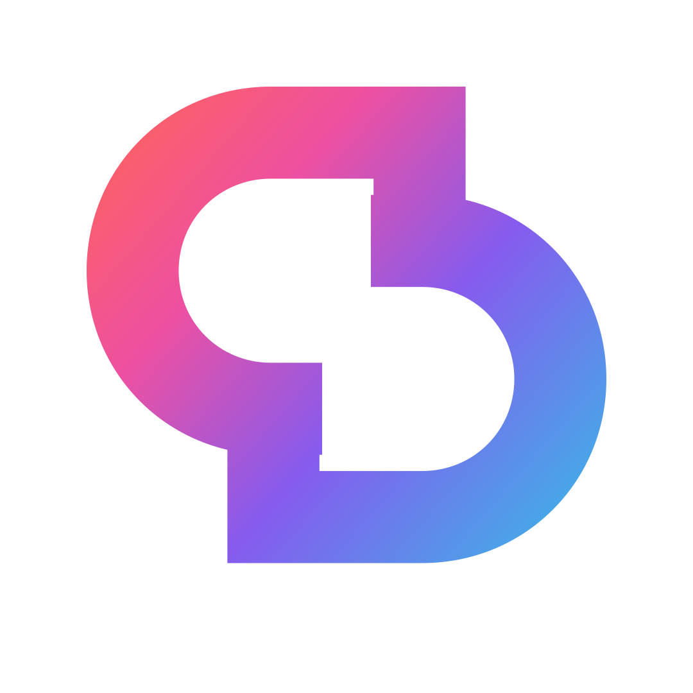
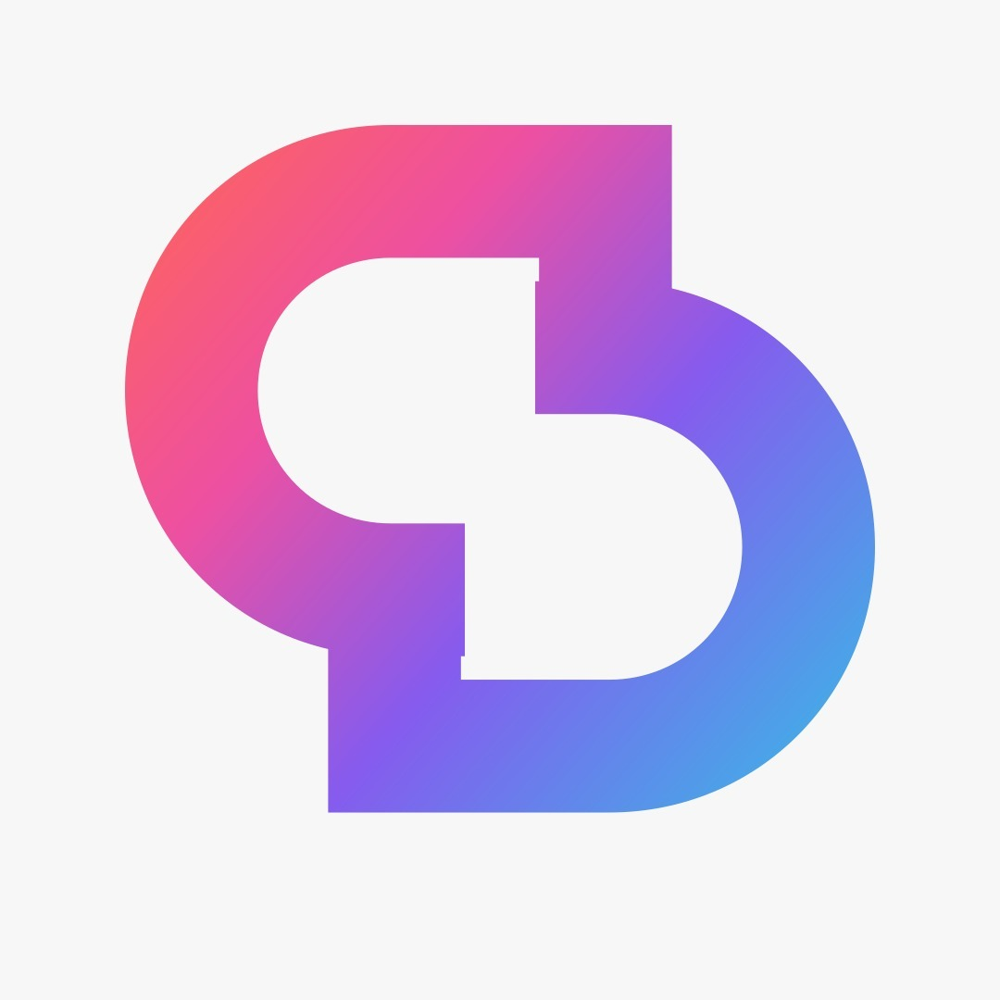
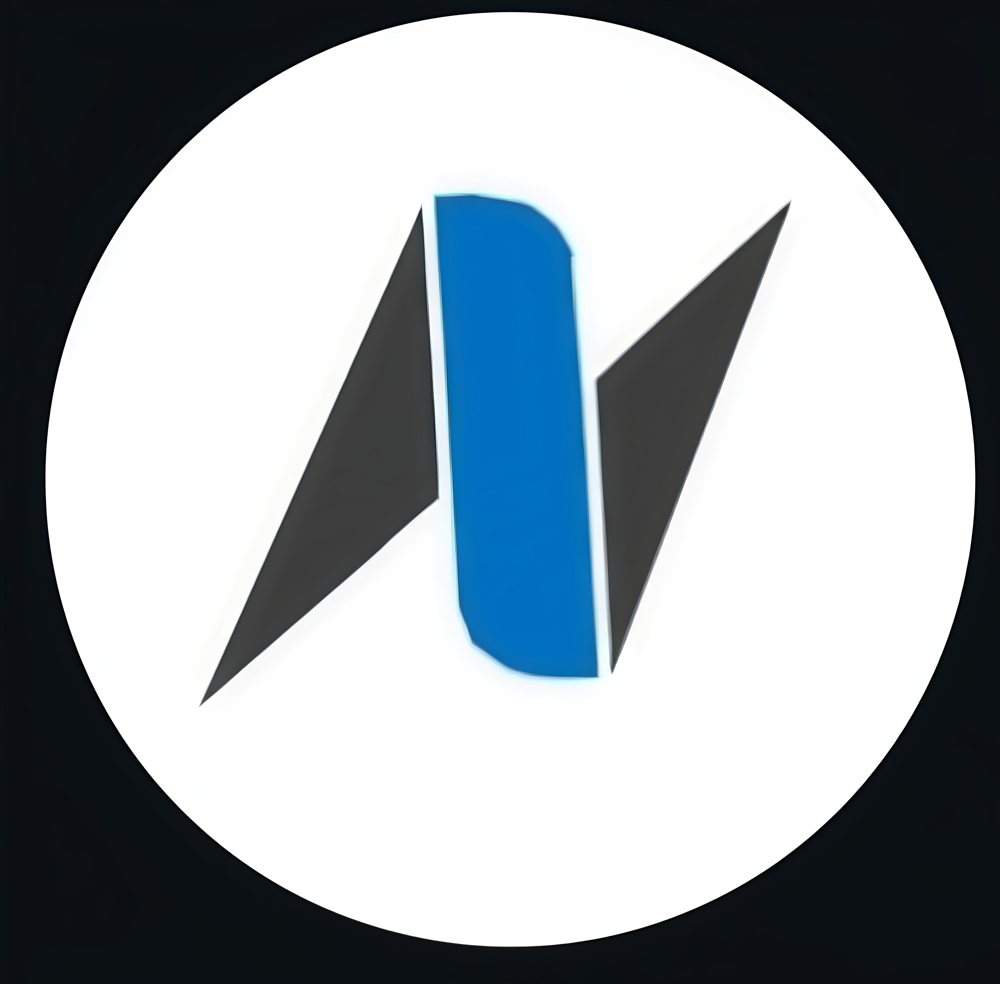

  
  <h1>A Jerrin Anto</h1>
  
<strong>Learner &amp; explorer</strong> · Founder @ ForMa · Tech Content Creator @ CodeWithJeru

  
Open source contributor · GSSoC ’26 &amp; OSCI ’26 · 7 hackathons · Exploring AI/ML &amp; Cloud

  

    
    
    
    
    
    
    
  

## About Me

I'm **A Jerrin Anto** — a **learner and explorer**, currently pursuing B.Tech CSE (AI & Machine Learning). I'm exploring AI/ML, cloud computing, and software development through hands-on projects, hackathons, and open-source contributions.

I learn by trying things, asking questions, and building with others. This profile brings together the projects, experiments, and experiences from that journey.

- 🏛️ **Founder at ForMa**: A dual startup initiative and collaborative developer community dedicated to building production products and mastering modern engineering stacks together.
- 🚀 **Startup Builder at Nexstep Network**: Co-developer architecting and validating product MVPs.
- 🎥 **Technology Content Creator**: I create and share technology-focused content on Instagram and YouTube, documenting what I learn, explore, and build. Check out the [Content Creation Based on Technology](#content-creation) section below for my channels.

- **Education** · **B.Tech CSE (AI & ML)** · Second-Year Undergraduate
- **Primary stack** · **Python • FastAPI • Next.js** · React • Flutter • Google Cloud
- **Experience** · **Internships @ Scaler School Of Technology, Hi Devs & Gigni** · GSSoC Contributor

> *"Code that isn't understood is just borrowed — I build to own what I ship."*

## Shipped & Featured Projects

### AQUA-ETHIC
**IoT × Blockchain × Water Quality Platform**

Water-quality monitoring platform that connects sensor telemetry with an Express API, SQLite storage, SHA-256 integrity checks, and Solidity blockchain anchoring.

- ESP32 water-quality telemetry ingestion
- Hash-based verification and historical sensor records
- Blockchain anchoring with a development simulator fallback

`ESP32` `Node.js` `Express` `SQLite` `Web3.js` `Solidity` `Hardhat`

### Lifeline
**Medical Records & AI Health Assistant**

A healthcare platform where doctors upload medical reports and patients ask Vitalis, an AI assistant, about their own health history through patient-controlled access.

- Tesseract and EasyOCR extraction from scanned reports
- AI extraction of diagnoses, medicines, and lab results
- Patient consent, role-based access, and structured medical records

`Python` `FastAPI` `Supabase` `PostgreSQL` `Tesseract` `EasyOCR` `Groq / LLaMA`

### Cardio.AI / WithLove
**Heart Risk Assessment & Visualization**

A cardiovascular risk assessment application combining clinical and lifestyle inputs, a Python prediction API, and a React interface with interactive heart visualizations.

- Risk prediction using clinical and lifestyle parameters
- Health input and risk-result dashboards
- Interactive 3D and AR heart visualization components

`React` `Tailwind CSS` `Python` `FastAPI` `scikit-learn` `Three.js`

### ResQ
**AI-Powered Disaster Response & Offline Coordination**

A Flutter disaster-response platform combining SOS reports, tactical maps, AI guidance, and nearby responder coordination, with peer-to-peer communication for no-internet environments.

- SOS reports with location and emergency context
- Nearby Connections peer-to-peer mesh communication
- AI assistance, voice interaction, and tactical maps

`Flutter` `Firebase` `Gemini` `ML Kit` `ElevenLabs` `Nearby Connections` `Google Maps`

## Tech Stack

| Focus | Tools and interests |
| --- | --- |
| AI & ML | PyTorch • Agentic AI • Vision |
| Full stack | FastAPI • Next.js • React |
| Cloud | Google Cloud • AWS • Deployments |
| Mobile & IoT | Flutter • Android • ESP32 • Arduino |
| Startups | ForMa • Nexstep • Production |

### Languages and databases

### AI and machine learning

### Web and backend

### Mobile and IoT

### Cloud and developer tools

## Achievements & Milestones

| Milestone | Context & Impact |
|---|---|
| 🥇 **1st Prize - Short Film Making** | Awarded first prize in competitive short film making, highlighting creative vision, storytelling, and direction. |
| 💼 **Scaler School Of Technology YIIC(Internship)** | Selected for an industry engineering internship at Scaler School Of Technology (June), acknowledged for standout technical delivery. |
| 🏁 **Top 100 Selection @ AiFi Hackathon** | Shortlisted among the Top 100 teams at the prestigious AiFi / HiFi Hackathon hosted at REVA University. |
| 🌊 **DECODE SIH Grand Finale (Top 50 Finalists)** | Selected for the National Grand Finale among the **Top 50 finalist teams** for AQUA-ETHIC. |
| 🇮🇳 **Internal Smart India Hackathon (SIH)** | Successfully qualified through university internal hackathon rounds for national SIH representation. |
| 🚀 **7 Hackathons & 5+ Tech Events** | Veteran of **7 hackathons** (including Namma Hack 2026, AI Rena 2.0, Google initiatives) and attendee/participant in 5+ technical conferences. |
| 💼 **Internships @ Hi Devs & Gigni** | Completed commercial software engineering and GenAI development internships, deploying production code. |
| 🌱 **GirlScript Summer of Code (GSSoC)** | Selected open-source contributor, contributing pull requests and features to active open-source projects. |
| ☁️ **Google Cloud Skill Badges** | Earned official Google Cloud skill badges spanning cloud infrastructure, model hosting, and generative AI. |
| 🏅 **Mr. Fresher Recognition** | Recognized as Mr. Fresher for excellence in communication, campus engagement, and creative presentation. |

## Leadership & Community

<table>
<tr>
<td align="center" width="200">
  
   <strong>ForMa</strong>
</td>
<td align="center" width="200">
  
   <strong>Nexstep Network</strong>
</td>
</tr>
</table>

- 🏛️ **Founder @ ForMa**: Founded **ForMa**, a dual startup venture and dedicated tech-learning community (WhatsApp & developer network) where members learn tech stacks, build products collaboratively, and participate in peer code reviews.
- 🎪 **Event Handling & Management @ Technexus Community**: Volunteer lead coordinating developer workshops, tech events, and community-building meetups.
- ⚡ **Startup Builder @ Nexstep Network**: Core co-developer collaborating on zero-to-one startup MVPs and product execution.

## Content Creation Based on Technology

&nbsp;

I create technology-focused content on **Instagram (@codewithjeru)** and **YouTube (Tech2007)**, sharing my learning journey, software builds, and experiments. Drawing on my work in AI and software development, I aim to make technical ideas easier to understand and encourage others to explore, learn, and build alongside me.

**Do like, support, and follow our channels!** Follow on Instagram and subscribe on YouTube to join the journey.

## Current Focus & Roadmap

- **Active now** · Building production-ready AI applications, Agentic AI & cloud infrastructure
- **Up next** · Deepening expertise in distributed systems, advanced cloud architecture & microservices
- **Long-term** · Scaling ForMa ventures, autonomous multi-agent systems & high-impact products

## GitHub Analytics

### Most Used Languages

  

## Connect & Collaborate

I'm actively open to:

- 💼 **Internship Opportunities** (AI/ML, Full-Stack, Cloud Computing)
- 🏁 **Hackathon & Tech Event Collaborations**
- 🤖 **AI & Full-Stack Product Engineering**
- 🚀 **Startup Discussions & Architecture**
- 🌐 **Joining the ForMa Community & Startup Ecosystem** (Build products & collaborate together!)

&nbsp;

&nbsp;

&nbsp;

Designed with precision • Built for production • Powered by Anto &amp; ForMa

